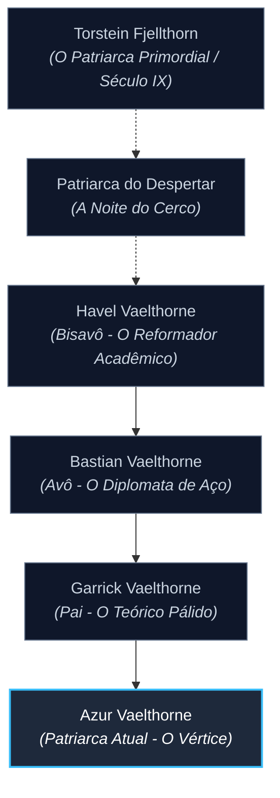

# A Grande Transição: De Guerreiros de Sangue a Eruditos do Silêncio

> [!quote] Pensamento de Havel Vaelthorne
> *"O bárbaro sangra na pedra e reza para que a tempestade pare. O sábio entende a geometria do raio e escreve a lei que o desfaz. Não seremos mais ovelhas com espadas; seremos os arquitetos do silêncio."*

Por gerações após a noite do cerco à mansão (ver **[[Vaelthorne]]** e **[[Origem dos Vaelthorne]]**), a linhagem operou como uma seita de guerreiros ferozes. Eles utilizavam a **[[Runomancia de Interdição]]** de forma intuitiva, brutal e reativa: feriam a si mesmos em fúria para calar as varinhas e focos de inimigos e subjugá-los no aço.

Contudo, com o advento das primeiras universidades arcanas, guildas de feitiçaria refinada e conspirações de corte, a brutalidade pura tornou-se uma fraqueza. A família precisava evoluir para não ser extinta.

---

## 1. O Ponto de Virada: O Bisavô (Havel Vaelthorne, *O Reformador*)

**Havel Vaelthorne** foi o homem que alterou para sempre o destino da casa. Testemunha de emboscadas onde jovens da família pereciam antes de conseguirem reagir com suas runas, Havel compreendeu que **não bastava silenciar a magia; era preciso compreendê-la melhor do que os próprios conjuradores.**

### Suas Reformas Históricas:
* **A Fundação do Scriptorium de Cinzas:** Transformou as masmorras e arsenais da mansão em uma das bibliotecas privadas mais impressionantes do continente, coletando tratados sobre tecelagem mágica, anatomia etérea e runologia comparada.
* **A Codificação da Interdição:** Deixou de ver a supressão mágica como um milagre de sangue e passou a tratá-la como uma **ciência geométrica precisa**. Mapeou as doze variações fundamentais das runas da [[Pedra Primordial]].
* **A Doutrina do Erudito:** Instituiu o preceito de que nenhum herdeiro empunharia uma lâmina sem antes ser capaz de ler e dissecar a sintaxe arcana dos maiores grimórios conhecidos.

---

## 2. A Inserção Política: O Avô (Bastian Vaelthorne, *O Diplomata de Aço*)

Filho de Havel, **Bastian Vaelthorne** herdou a biblioteca do pai e a levou para os círculos de poder. Em uma época em que lordes e reis temiam a influência desmedida das ordens arcanas, Bastian posicionou os Vaelthorne como uma **aristocracia necessária e neutra**.

* **Os Juízes Mudos:** Ofereceu os serviços da família como árbitros e inspetores em tratados mágicos de alta periculosidade. Onde havia um Vaelthorne presente, nenhum arquimago ousava erguer sua varinha sob pena de ter o fluxo do canalizador rompido instantaneamente.
* **Refinamento Nobiliárquico:** Adotou os costumes, o vestuário e a oratória da alta nobreza, afastando de vez o estigma de "bárbaros nórdicos reclusos" e consolidando o prestígio social da casa.

---

## 3. A Crise da Teoria Pura: O Pai (Garrick Vaelthorne, *O Teórico Pálido*)

**Garrick Vaelthorne** aprofundou o intelecto da família a níveis quase obsessivos, mas revelou o custo do distanciamento marcial:

* **Inovações Alquímicas:** Desenvolveu os primeiros métodos de preservar o sangue da linhagem em tintas alquímicas especiais e vitríolos metálicos, permitindo pré-gravar runas ativas em pergaminhos de contenção e placas de [[Ferro Frio]].
* **A Fraqueza Física:** Garrick era um homem doente e absorto em tomos. Sob sua liderança complacente nos campos de treino, a família quase esqueceu como duelar de perto. Inimigos arcanos perceberam a hesitação prática da casa e voltaram a conspirar contra as sombras dos Vaelthorne.

---

## 4. O Patriarca Atual: [[Azur Vaelthorne]] (*A Síntese Perfeita*)

Ciente dos erros e acertos de seus antepassados, o atual patriarca **[[Azur Vaelthorne]]** assumiu a liderança da casa restaurando a harmonia entre o livro e a espada. 

Azur não renegou a erudição do bisavô Havel, mas reviveu o vigor dos guerreiros do norte. Sob seu comando:
* O estudo acadêmico é agora a ferramenta com que se planeja o combate: **conhecer o feitiço do rival antes mesmo dele começar a pronunciá-lo, para interceptá-lo no primeiro fonema.**
* A casa Vaelthorne atingiu o ápice de sua sofisticação e letalidade.

---

## Árvore Genealógica Recente

---

## Conexões & Registros

- **Patriarca Vigente:** [[Azur Vaelthorne]]
- **História & Raízes:** [[Origem dos Vaelthorne]] | [[Vaelthorne]]
- **Artes & Conhecimento:** [[Runomancia de Interdição]] | [[Pedra Primordial]] | [[Ferro Frio]]
